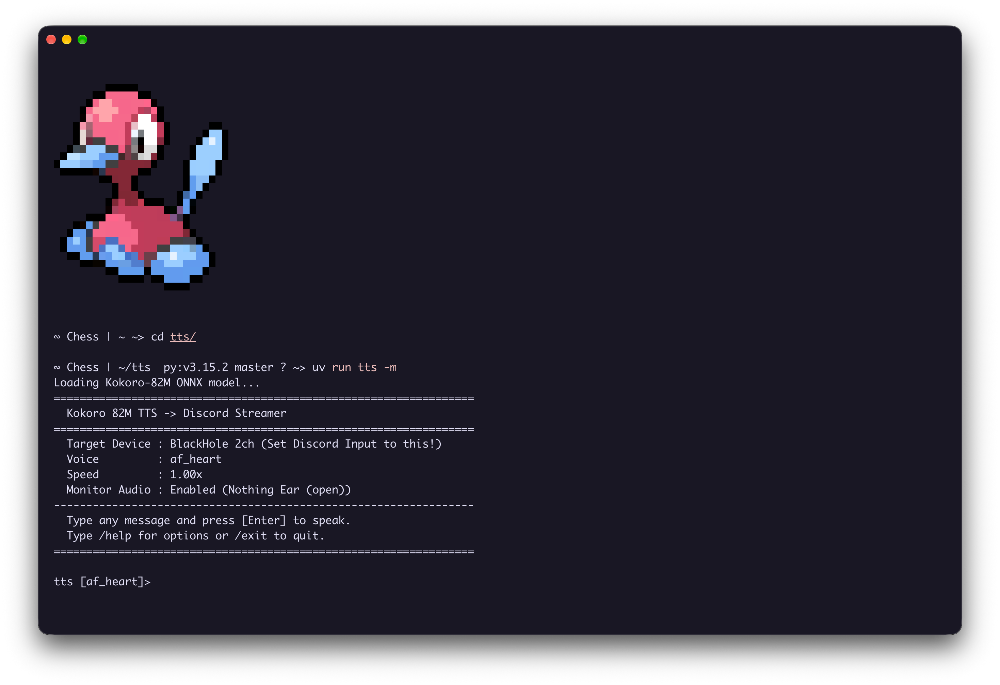

# 🎙️ Kokoro TTS -> Discord Streamer

<p align="center">
  
  
  
  
  
  
</p>

An interactive real-time CLI tool that streams natural, high-fidelity neural speech synthesized by **Kokoro 82M (ONNX)** directly into **Discord**, **Zoom**, **Teams**, or any VoIP app as your virtual microphone input.

<p align="center">
  
</p>

---

## ✨ Features

- **⚡ Real-Time Streaming Playback**: Chunks are streamed asynchronously to the audio device buffer as the neural model generates them, delivering instant speech without waiting for full synthesis.
- **🎧 Dual-Stream Audio Monitoring (`-m`)**: Simultaneously route speech to your virtual microphone *and* mirror it to your personal headphones/speakers so you hear what you type.
- **🧠 100% Local & Offline**: Powered by ONNX Runtime with the lightweight, expressive Kokoro 82M model. No OpenAI/ElevenLabs API keys, no subscription fees, and no cloud latency.
- **🔄 Universal Virtual Cable Support**: Auto-detects virtual audio devices across macOS (`BlackHole`), Windows (`VB-Cable`), and Linux (`PipeWire / PulseAudio`).
- **💬 Interactive Terminal REPL**: Full GNU `readline` keyboard navigation, history, and on-the-fly slash commands (`/voice`, `/speed`, `/monitor`, `/devices`) without needing to restart the session.
- **📦 Zero-Config Asset Download**: Automatically downloads and caches ONNX weights (~300MB) and voice vector arrays with animated progress bars on first run.

---

## 🏗️ Audio Pipeline Architecture

```text
 ┌──────────────────────┐
 │  Terminal CLI Input  │  (Interactive REPL / readline)
 └──────────┬───────────┘
            │
            ▼
 ┌──────────────────────┐
 │   Kokoro 82M ONNX    │  (Local Neural TTS / Async Stream)
 └──────────┬───────────┘
            │ 24 kHz float32 Audio Chunks
            ▼
 ┌──────────────────────┐
 │  StreamPlayer Engine │  (sounddevice / PortAudio)
 └─────┬──────────┬─────┘
       │          │
       │ (Primary)│ (Optional Monitor -m)
       ▼          ▼
 ┌──────────────┐ ┌──────────────────────┐
 │ Virtual Mic  │ │ Personal Headphones  │
 │ (BlackHole / │ │ (MacBook Speakers /  │
 │  VB-Cable)   │ │  AirPods / IEMs)     │
 └──────┬───────┘ └──────────────────────┘
        │
        ▼
 ┌──────────────────────┐
 │ Discord / Zoom / Meet│
 └──────────────────────┘
```

---

## 🚀 Quick Start

### Option 1: Run instantly with `uvx` (No git clone needed)

If you have [`uv`](https://docs.astral.sh/uv/) installed:

```bash
uvx --from git+https://github.com/Qeya/tts.git tts -m
```

### Option 2: Clone and run locally

```bash
# 1. Clone repo
git clone https://github.com/Qeya/tts.git
cd tts

# 2. Launch with uv (auto-creates virtualenv & downloads dependencies)
uv run tts -m
```

> **Tip**: The `-m` (`--monitor`) flag enables mirroring audio to your headphones so you can listen along with your stream.

---

## 🎛️ Virtual Audio Driver Setup (Cross-Platform)

This tool transmits audio to a **virtual audio cable**, which acts as your microphone in voice apps:

### 🍏 macOS (BlackHole)
1. Install BlackHole 2ch via Homebrew:
   ```bash
   brew install blackhole-2ch
   ```
2. The CLI will automatically detect `BlackHole 2ch`.

### 🪟 Windows (VB-Audio Cable)
1. Download and install the free [VB-Audio Virtual Cable](https://vb-audio.com/Cable/).
2. Reboot or restart your audio services.
3. The CLI will automatically detect `CABLE Input`.

### 🐧 Linux (PulseAudio / PipeWire)
Create a persistent virtual microphone null-sink:
```bash
pactl load-module module-null-sink sink_name=VirtualMic sink_properties=device.description=VirtualMic
pactl load-module module-remap-source master=VirtualMic.monitor source_name=VirtualMic_Mic source_properties=device.description=VirtualMic_Mic
```
The CLI will automatically detect `VirtualMic`.

---

## 🎙️ VoIP & Discord Configuration

1. Open **Discord** (or Zoom / Google Meet / OBS) ➔ **Settings** ➔ **Voice & Video**.
2. **Input Device**: Select your virtual driver (`BlackHole 2ch`, `CABLE Output`, or `VirtualMic`).
3. **Output Device**: Keep this set to your real headphones/speakers (e.g., *Headphones*, *MacBook Speakers*).
4. **Input Sensitivity**:
   - Turn **OFF** *"Automatically determine input sensitivity"*.
   - Set the manual slider to approximately `-55 dB` so the synthesized speech is never clipped.
   - Disable *"Echo Cancellation"* and set *"Noise Suppression"* to **None** to preserve high-fidelity neural audio dynamics.

---

## ⌨️ In-Session Slash Commands

While in the interactive prompt, you can configure speech parameters on the fly:

| Command | Description | Example |
|---|---|---|
| `/voice <name>` | Switch active voice instantaneously | `/voice am_michael` |
| `/voices` | Display categorized catalog of voices | `/voices` |
| `/speed <val>` | Adjust playback speed multiplier (`0.5` – `2.5`) | `/speed 1.15` |
| `/monitor <on\|off>` | Toggle live headphone feedback | `/monitor on` |
| `/device` | Show currently assigned audio devices | `/device` |
| `/devices` | List all system audio output devices & indices | `/devices` |
| `/clear` | Clear terminal screen | `/clear` |
| `/help` | Print help cheatsheet | `/help` |
| `/exit` or `quit` | Exit application | `/exit` |

---

## 🛠️ CLI Flags & Options

```bash
uv run tts [options]
```

```text
options:
  -h, --help            Show this help message and exit
  -v, --voice VOICE     Kokoro voice name (default: af_heart)
  -s, --speed SPEED     Speech speed multiplier (default: 1.0)
  -d, --device DEVICE   Target output device index or substring (default: auto-detected virtual cable)
  -m, --monitor         Mirror audio to default headphones/speakers simultaneously
  --monitor-device DEV  Explicit output device index or name for audio monitor
  --list-devices        List all available audio output devices and exit
  --list-voices         List all Kokoro voices and exit
```

---

## 🗣️ Supported Voices

Kokoro supports multi-accented voices out of the box:

- **American Female (`af_*`)**: `af_heart`, `af_alloy`, `af_aoede`, `af_bella`, `af_jessica`, `af_kore`, `af_nicole`, `af_nova`, `af_river`, `af_sarah`, `af_sky`
- **American Male (`am_*`)**: `am_adam`, `am_echo`, `am_eric`, `am_fenrir`, `am_liam`, `am_michael`, `am_onyx`, `am_puck`
- **British Female (`bf_*`)**: `bf_alice`, `bf_emma`, `bf_isabella`, `bf_lily`
- **British Male (`bm_*`)**: `bm_daniel`, `bm_fable`, `bm_george`, `bm_lewis`

---

## 📄 License

Distributed under the [MIT License](LICENSE).

## 🙏 Acknowledgments

- [Kokoro-82M](https://huggingface.co/hexgrad/Kokoro-82M) by hexgrad.
- [kokoro-onnx](https://github.com/thewh1teagle/kokoro-onnx) by thewh1teagle.
- [sounddevice](https://python-sounddevice.readthedocs.io/) & PortAudio.
